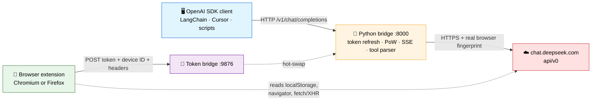

<div align="center">

# DeepSeek Web → OpenAI Bridge

**Turn DeepSeek's free web API into a fully OpenAI-compatible endpoint.**

Point any SDK at `http://127.0.0.1:8000/v1` — streaming, reasoning traces, tool calls, session persistence, and automatic token rotation included.

[](https://www.python.org/)
[](https://fastapi.tiangolo.com/)
[](https://www.gnu.org/licenses/gpl-3.0)
[]()
[]()

[Features](#-features) · [Quick Start](#-quick-start) · [How It Works](#-how-it-works) · [API](#-api-reference) · [Troubleshooting](#-troubleshooting) · [FAQ](#-faq) · [License](#-license)

</div>

---

## Why this exists

DeepSeek's official API is paid. Their web app at `chat.deepseek.com` is free — and behind the scenes, it talks to an internal HTTP API that any browser can reach.

This project bridges the two worlds:

- **Any OpenAI client** — LangChain, LlamaIndex, Cursor, Continue.dev, Open WebUI, your own scripts
- **Zero cost** — uses your free web account
- **Real browser fingerprint** — every request carries your actual User-Agent, cookies, and client hints
- **Self-healing** — token rotation and device ID capture are automatic
- **Agent-ready** — tool calls via JSON with stall recovery

No headless Chromium. No paid key. No brittle reverse engineering that breaks every week.

---

## ✨ Features

<table>
<tr>
<td width="50%" valign="top">

### 🔌 OpenAI-compatible protocol

- `POST /v1/chat/completions` (streaming + non-streaming)
- `GET /v1/models`
- `stream_options.include_usage`
- `tool_calls` in responses
- `reasoning_content` for R1

</td>
<td width="50%" valign="top">

### 🛡️ Self-healing auth

- Auto-refresh 1-hour access tokens
- Auto-rotate `userToken` via browser extension
- Auto-capture `x-device-id` from live page
- Real cookie replay (`aws-waf-token` included)
- No manual paste after first setup

</td>
</tr>
<tr>
<td width="50%" valign="top">

### 🧠 Agent mode

- JSON tool calls (`<tool_calls>[...]</tool_calls>`)
- Stall recovery when the model forgets to act
- Empty-response recovery with auto-reset
- Session size cap to prevent dead-ends
- System prompt authority framing

</td>
<td width="50%" valign="top">

### 🎭 Fingerprint fidelity

- Real `User-Agent` from `navigator.userAgent`
- Real `Accept-Language` from `navigator.languages`
- Real `Sec-CH-UA*` from `navigator.userAgentData`
- Real session cookie
- Real per-browser instance IDs

</td>
</tr>
</table>

---

## 🚀 Quick Start

### 1. Clone

```bash
git clone https://github.com/minecraftbefile-maker/deepseek-bridge.git
cd deepseek-bridge
```

### 2. Install dependencies

```bash
pip install -r requirements.txt
```

### 3. Download DeepSeek's PoW WASM (one time)

```bash
# Linux / macOS
curl -o sha3_wasm_bg.wasm \
  https://fe-static.deepseek.com/chat/static/sha3_wasm_bg.7b9ca65ddd.wasm

# Windows
curl -o sha3_wasm_bg.wasm ^
  https://fe-static.deepseek.com/chat/static/sha3_wasm_bg.7b9ca65ddd.wasm
```

### 4. Create your `.env`

```bash
cp .env.example .env        # Linux / macOS
copy .env.example .env      # Windows
```

The defaults work out of the box. Edit `.env` only if you want to change ports or add a bridge API key.

### 5. Start the server

```bash
python main.py
```

You'll be asked to pick a mode:

```
+----------------------------------------------------------------+
|  Select bridge mode                                            |
+----------------------------------------------------------------+
|  [a] AGENT mode - tools via JSON tool_calls, no thinking       |
|  [c] CHAT mode  - plain conversation, no tool parsing          |
+----------------------------------------------------------------+
Choice [a]: a
```

### 6. Install the browser extension

**Chromium (Chrome, Edge, Brave, Opera):**

1. `chrome://extensions/` → **Developer mode ON**
2. **Load unpacked** → select `extension/chromium/`

**Firefox:**

1. `about:debugging#/runtime/this-firefox`
2. **Load Temporary Add-on…** → select `extension/firefox/manifest.json`

> [!IMPORTANT]
> Disable uBlock Origin (or any ad blocker) on `chat.deepseek.com`. It blocks the extension's POST to `127.0.0.1:9876`.

### 7. Open DeepSeek once

Visit `https://chat.deepseek.com` and log in. Within seconds the bridge learns your credentials:

```
[bridge] new userToken from chromium:... (64 chars)
[bridge] new device ID: 2f40faef-17d8-47fa-8802-13dc6a2a5590
[bridge] new header bundle (16 headers) from chromium:...
[bridge]   user-agent: Mozilla/5.0 (Windows NT 10.0; Win64; x64) ... Chrome/152.0.0.0 ...
```

**You're done.** Point any OpenAI client at `http://127.0.0.1:8000/v1`.

### 8. Test it

```bash
curl http://127.0.0.1:8000/v1/chat/completions \
  -H "Content-Type: application/json" \
  -d '{
    "model": "deepseek-chat",
    "messages": [{"role": "user", "content": "Say hi in 3 words"}]
  }'
```

---

## 🔧 How It Works



**The flow in six steps:**

1. Client sends `POST /v1/chat/completions` to the bridge
2. Bridge solves the WASM proof-of-work challenge
3. Bridge attaches the current access token + your real browser fingerprint
4. DeepSeek streams back SSE frames
5. Bridge parses them and re-emits OpenAI `chat.completion.chunk` events
6. Extension keeps the token, device ID, and headers fresh — no restarts

### Two-token model

| Token | Lifetime | Source | Purpose |
|:--|:--|:--|:--|
| `userToken` | Days–weeks | `localStorage["userToken"]` | Long-lived refresh token |
| Access token | 1 hour | `GET /api/v0/users/current` | API authorization header |

Bridge refreshes the access token. Extension rotates the `userToken`. Together, self-healing.

### Proof of work

Every `/chat/completion` request must be signed with a `DeepSeekHashV1` PoW signature in the `x-ds-pow-response` header. The bridge runs DeepSeek's own `sha3_wasm_bg.wasm` in `wasmtime` — the exact same code the browser runs.

---

## ⚙️ Configuration

All settings live in `.env`.

| Variable | Default | Description |
|:--|:--|:--|
| `DEEPSEEK_USER_TOKEN` | *(empty)* | Optional starting token. Extension supplies it if empty. |
| `DEEPSEEK_COOKIE` | *(empty)* | Optional cookie string. Rarely needed. |
| `DEEPSEEK_DEVICE_ID` | *(empty)* | Optional device ID. Loaded from `.ds_device_id` if empty. |
| `BRIDGE_API_KEY` | *(empty)* | If set, `/v1/*` requires `Authorization: Bearer <key>`. |
| `BIND_HOST` | `127.0.0.1` | HTTP listen address. |
| `BIND_PORT` | `8000` | HTTP listen port. |
| `TOKEN_BRIDGE_PORT` | `9876` | Port the extension pushes to. |
| `MAX_CONTINUATION_CHARS` | `12000` | Session size cap. Above this, the bridge folds into a fresh session. |
| `REINFORCE_SYSTEM` | `1` | Reinject system prompt reminders on continuation turns. |
| `RESET_ON_SYSTEM_CHANGE` | `0` | Reset session when the client changes its system prompt. |
| `DEEPSEEK_DEBUG` | `0` | Set to `1` for verbose SSE logging. |

<details>
<summary><b>Example <code>.env</code></b></summary>

```ini
# --- DeepSeek credentials (optional, extension fills these) ---
DEEPSEEK_USER_TOKEN=
DEEPSEEK_COOKIE=
DEEPSEEK_DEVICE_ID=

# --- Bridge auth ---
BRIDGE_API_KEY=sk-local-change-me

# --- Network ---
BIND_HOST=127.0.0.1
BIND_PORT=8000
TOKEN_BRIDGE_PORT=9876

# --- Behaviour ---
MAX_CONTINUATION_CHARS=12000
REINFORCE_SYSTEM=1
RESET_ON_SYSTEM_CHANGE=0

# --- Debug ---
DEEPSEEK_DEBUG=0
```
</details>

---

## 📖 Usage

### Python

```python
from openai import OpenAI

client = OpenAI(
    base_url="http://127.0.0.1:8000/v1",
    api_key="sk-local-change-me",
)

# Simple completion
resp = client.chat.completions.create(
    model="deepseek-chat",
    messages=[
        {"role": "system", "content": "You are a concise assistant."},
        {"role": "user", "content": "What is the capital of France?"},
    ],
)
print(resp.choices[0].message.content)

# Streaming with reasoning traces
stream = client.chat.completions.create(
    model="deepseek-reasoner",
    messages=[{"role": "user", "content": "Solve 17 x 23 step by step."}],
    stream=True,
)
for chunk in stream:
    if chunk.choices:
        d = chunk.choices[0].delta
        if getattr(d, "reasoning_content", None):
            print(f"\033[90m{d.reasoning_content}\033[0m", end="")
        elif d.content:
            print(d.content, end="")
```

### Node.js

```javascript
import OpenAI from "openai";

const client = new OpenAI({
  baseURL: "http://127.0.0.1:8000/v1",
  apiKey: "sk-local-change-me",
});

const stream = await client.chat.completions.create({
  model: "deepseek-chat",
  messages: [{ role: "user", content: "Say hi in three words." }],
  stream: true,
});

for await (const chunk of stream) {
  process.stdout.write(chunk.choices[0]?.delta?.content ?? "");
}
```

### Compatible tools

| Tool | Configuration |
|:--|:--|
| **LangChain** | `ChatOpenAI(base_url="http://127.0.0.1:8000/v1", api_key="sk-local")` |
| **LlamaIndex** | `OpenAI(base_url="http://127.0.0.1:8000/v1", api_key="sk-local")` |
| **Open WebUI** | Settings → Connections → OpenAI → URL `http://127.0.0.1:8000/v1` |
| **Continue.dev** | `models[].apiBase = "http://127.0.0.1:8000/v1"` |
| **Cursor / Windsurf** | Custom OpenAI provider with the same base URL |
| **Chatbox** | Settings → API → Base URL `http://127.0.0.1:8000/v1` |

### Model names

| Model string | Routes to | Thinking |
|:--|:--|:--|
| `deepseek-chat` | V3 (default) | Off |
| `deepseek-reasoner` | R1 (expert) | On → emitted as `reasoning_content` |
| `auto` | Same as `deepseek-chat` | Off |
| Any other string | Treated as `deepseek-chat` | Off |

---

## 🎛️ Modes

| Feature | AGENT | CHAT |
|:--|:--:|:--:|
| Tool calls via JSON | ✅ | ❌ |
| Thinking enabled | ❌ (direct output) | ❌ |
| Stall recovery | ✅ | ❌ |
| Empty-response recovery | ✅ | ✅ |
| Session size cap | ✅ | ✅ |
| System prompt reinforcement | per turn | once |
| Best for | Coding agents, tool frameworks | Chatbots, quick prompts |

### Runtime commands

Type these in the terminal that's running `python main.py`:

| Command | Action |
|:--|:--|
| `agent` or `a` | Switch to AGENT mode (resets session) |
| `chat` or `c` | Switch to CHAT mode (resets session) |
| `status` or `s` | Show current mode and session |
| *(Enter)* | Start a new chat session |

---

## 🌐 API Reference

### `POST /v1/chat/completions`

Standard OpenAI endpoint.

<details>
<summary><b>Request body</b></summary>

| Field | Type | Notes |
|:--|:--|:--|
| `messages` | array | **Required.** OpenAI message list. |
| `model` | string | See model table. |
| `stream` | boolean | Enables SSE streaming. |
| `stream_options.include_usage` | boolean | Emits final usage chunk. |
| `tools`, `tool_choice` | any | Accepted. Model learns from system prompt. |

**Accepted but ignored:** `temperature`, `top_p`, `max_tokens`, `stop`, `seed`, `presence_penalty`, `frequency_penalty`, `response_format`.
</details>

### `POST /api/fresh`

Resets the session. Next request starts a new chat.

```bash
curl -X POST http://127.0.0.1:8000/api/fresh
```

```json
{
  "status": "ok",
  "message": "session reset - next request starts a new chat",
  "previous_session_id": "2f27ea8c-4449-4585-b1d1-689784f0fe3b"
}
```

### `GET /health`

```json
{
  "status": "ok",
  "mode": "agent",
  "session_id": "2f27ea8c-...",
  "turn_count": 1,
  "device_id": "2f40faef-...",
  "user_agent": "Mozilla/5.0 ... Chrome/152.0.0.0 ...",
  "browser_headers_count": 16,
  "access_token_expires_in": 3573,
  "user_token_source": "extension(chromium:chromium-...)",
  "user_token_age_seconds": 277
}
```

### `GET /v1/models`

Standard OpenAI model listing.

---

## 📁 Project Structure

```
deepseek-bridge/
├── 📄 main.py                    # Entire Python server (single file, easy to audit)
├── 📄 requirements.txt
├── 📄 .env.example
├── 📄 .gitignore
├── 📄 README.md
├── 📄 LICENSE                    # GPL-3.0
├── 🧊 sha3_wasm_bg.wasm          # Downloaded separately (gitignored)
├── 💾 .ds_usertoken              # Cached token (gitignored)
├── 💾 .ds_device_id              # Cached device ID (gitignored)
├── 💾 .ds_headers.json           # Cached browser headers (gitignored)
└── 📂 extension/
    ├── 📂 chromium/
    │   ├── manifest.json         # Manifest V3
    │   ├── background.js         # Service worker
    │   ├── content.js            # localStorage + postMessage
    │   └── inject.js             # fetch/XHR hooks (main world)
    └── 📂 firefox/
        ├── manifest.json         # Manifest V2
        ├── background.js         # Persistent background page
        ├── content.js
        └── inject.js
```

`main.py` is intentionally self-contained. No packages, no submodules.

---

## 🔥 Troubleshooting

<details>
<summary><b>Bridge says <code>waiting for browser extension</code></b></summary>

The extension hasn't pushed anything yet.

1. Confirm the extension is loaded and enabled
2. Open `https://chat.deepseek.com` and log in
3. Check the page console for `[DS/inject] hooks installed` and `[DS] pushed:`
4. If nothing appears, disable ad blockers and reload
</details>

<details>
<summary><b><code>user_agent: ?</code> in <code>/health</code></b></summary>

The extension is loaded but hasn't captured headers. Send one message in the DeepSeek chat UI to trigger the fetch hook.
</details>

<details>
<summary><b>uBlock / AdGuard blocks the bridge</b></summary>

uBlock blocks the extension's POST to `127.0.0.1:9876`.

**Fix:** Disable the blocker for `chat.deepseek.com`, or add to **My filters**:

```
@@||chat.deepseek.com^$document
@@||127.0.0.1^$document
```
</details>

<details>
<summary><b><code>INVALID_POW_RESPONSE (code=40301)</code></b></summary>

The WASM file is missing or stale.

```bash
curl -o sha3_wasm_bg.wasm \
  https://fe-static.deepseek.com/chat/static/sha3_wasm_bg.7b9ca65ddd.wasm
```

Restart. You should see `[wasm] loaded sha3_wasm_bg.wasm`.
</details>

<details>
<summary><b><code>AUTH_INVALID_OR_EXPIRED (code=40101)</code></b></summary>

Log out and back in on `chat.deepseek.com` with the extension loaded. It will push a fresh token.
</details>

<details>
<summary><b><code>RISK_DEVICE_DETECTED (code=11)</code></b></summary>

DeepSeek flagged your account. Usually means the device ID doesn't match your real browser.

1. On `chat.deepseek.com`, F12 → Network
2. Send a message, click the `completion` request
3. Copy the `x-device-id` header value
4. Compare with `curl http://127.0.0.1:8000/health | findstr device_id`

If they differ: `del .ds_device_id` and let the extension re-push.
</details>

<details>
<summary><b><code>ACCOUNT_BANNED (code=5)</code></b></summary>

DeepSeek has banned your account. Use a different one.
</details>

<details>
<summary><b>Model stalls — task ends with "(done)" without completing</b></summary>

Session hit DeepSeek's budget. The bridge handles this automatically:

```
[session] continuation too large (18787 chars > 12000) - folding full history in a fresh session
```

If it still stalls, lower `MAX_CONTINUATION_CHARS` in `.env`.
</details>

<details>
<summary><b><code>ERR_NAME_NOT_RESOLVED</code> for <code>hif-dliq.deepseek.com</code></b></summary>

DeepSeek's own telemetry endpoint, blocked by DNS. Unrelated to the bridge. Ignore.
</details>

<details>
<summary><b><code>WebAssembly.instantiateStreaming failed</code></b></summary>

DeepSeek's own PoW module, served with the wrong MIME type by their CDN. Only affects the web UI. Ignore.
</details>

<details>
<summary><b>Extension doesn't pick up edits</b></summary>

Chromium caches content scripts. After editing:

1. `chrome://extensions/` → click the reload icon
2. **Close** the `chat.deepseek.com` tab (not just refresh)
3. Open a fresh tab
</details>

---

## ❓ FAQ

<details>
<summary><b>Do I need a paid DeepSeek API key?</b></summary>

No. The bridge uses your free web account. You only need a browser logged into `chat.deepseek.com`.
</details>

<details>
<summary><b>Is this against DeepSeek's Terms of Service?</b></summary>

Possibly. DeepSeek's ToS restrict automated access. Use this for personal, educational, and low-volume use. Do not resell access.
</details>

<details>
<summary><b>Will I get banned?</b></summary>

Low-volume personal use is generally fine. To reduce risk:

- Keep concurrency low (bridge already serializes)
- Use the session reuse feature (automatic)
- Use a throwaway account if worried
- Don't run parallel agent workers
</details>

<details>
<summary><b>How long does the userToken last?</b></summary>

Typically 1–4 weeks. Can be invalidated at any time. The extension handles rotation silently.
</details>

<details>
<summary><b>Can I run this on a headless server?</b></summary>

Yes. Paste a fresh `userToken` into `.env` and refresh it manually every few weeks. The extension is only needed for automatic rotation.
</details>

<details>
<summary><b>Does it support function calling?</b></summary>

Yes, via agent mode. The model emits `<tool_calls>[...]</tool_calls>` JSON which the bridge parses into standard OpenAI `tool_calls`. The client's `tools` parameter isn't forwarded — the model learns about tools from the system prompt.
</details>

<details>
<summary><b>Why JSON instead of DeepSeek's DSML format?</b></summary>

DeepSeek's native DSML tool-call syntax is unreliable for models not specifically trained on it. Parameters get dropped, blocks get truncated, parallel calls get mangled. JSON is easy for the model to produce correctly and easy for the bridge to parse.
</details>

<details>
<summary><b>Does it support vision or images?</b></summary>

Not currently.
</details>

<details>
<summary><b>Why WASM instead of pure Python for PoW?</b></summary>

DeepSeek's PoW uses a non-standard Keccak variant with float64 nonces. It cannot be reproduced with `hashlib`. The WASM module is the only reliable implementation.
</details>

<details>
<summary><b>How much memory does the server use?</b></summary>

About 60 MB at idle, plus about 2 MB per concurrent request. The WASM instance is roughly 15 MB.
</details>

<details>
<summary><b>Can I run multiple accounts?</b></summary>

Not recommended. Each account needs its own browser profile and its own device ID. Multiple accounts sharing a device ID get banned together.
</details>

<details>
<summary><b>Can I run this on a different port?</b></summary>

Yes. Set `BIND_PORT` in `.env`, and change `BRIDGE_URL` in the extension's `content.js` if you also change `TOKEN_BRIDGE_PORT`. Reload the extension.
</details>

---

## 🔒 Security Notes

> **The bridge runs on your machine with full access to your DeepSeek account. Read this section.**

### Bind address

Default is `127.0.0.1` — only your machine can reach it. **Do not** change `BIND_HOST` to `0.0.0.0` unless you also set `BRIDGE_API_KEY`. On shared Wi-Fi, binding to `0.0.0.0` without auth means anyone on the network can burn your quota or read your prompts.

### Bridge API key

When `BRIDGE_API_KEY` is set, all `/v1/*` requests must include:

```
Authorization: Bearer <your key>
```

The token bridge (`:9876`) is separate and doesn't require this key — it only accepts POSTs from the extension's fetch context. It writes whatever token it receives to `.ds_usertoken`, which is a local-file trust assumption.

### Browser extension permissions

Both extensions request:

- `storage` and `alarms` — extension-internal APIs
- `https://chat.deepseek.com/*` — to read localStorage and hook fetch
- `http://127.0.0.1/*` and `http://localhost/*` — to POST to the bridge

Neither extension reads any other site's data. Neither sends anything off your machine.

### `.env`

May contain `DEEPSEEK_USER_TOKEN` and `DEEPSEEK_COOKIE`. Both grant access to your DeepSeek account. **Never commit `.env`.** The included `.gitignore` excludes it.

### Token leakage

If you share screenshots of the extension console or terminal, redact the long base64-looking strings. JWTs and session cookies are the sensitive parts.

### TLS

The bridge uses plain HTTP on loopback. Fine for local use. Do not expose it through a reverse proxy without adding TLS and `BRIDGE_API_KEY`.

### Rule of thumb

If you wouldn't hand someone your browser session, don't hand them access to this bridge.

---

## 🧑‍💻 Development

### Extending the bridge

`main.py` is organized into clearly labeled sections:

1. `.env` loading
2. Configuration constants
3. Stall detection regex
4. Mode selection prompt
5. System prompt templates
6. Tool-call parser (JSON + DSML fallback)
7. Device ID loader
8. Token bridge (HTTP server for the extension)
9. Token manager (access token refresh)
10. Session state
11. WASM PoW solver
12. DeepSeek client
13. Prompt builders
14. Response builders
15. FastAPI app + endpoints

### Adding an endpoint

Copy the pattern from `/api/fresh`:

```python
@app.post("/api/your-endpoint")
async def your_endpoint():
    return {"status": "ok"}
```

### Extending the tool-call parser

The parser lives in `_parse_json_tool_calls`. It already handles:

- `{"name": ..., "arguments": {...}}`
- Nested `{"function": {"name": ..., "arguments": {...}}}`
- Wrapped `{"name": "tool_calls", "arguments": [...]}`

If DeepSeek starts emitting a new shape, add it there.

### Testing

```bash
# Health check
curl http://127.0.0.1:8000/health

# Fresh session
curl -X POST http://127.0.0.1:8000/api/fresh

# Simple completion
curl http://127.0.0.1:8000/v1/chat/completions \
  -H "Content-Type: application/json" \
  -d '{"model": "deepseek-chat", "messages": [{"role": "user", "content": "hi"}]}'
```

---

## 📜 Changelog

### v1.5.0
- Added `/api/fresh` endpoint for programmatic session reset
- Added empty-response recovery in both streaming and non-streaming paths
- Added `MAX_CONTINUATION_CHARS` to prevent session exhaustion
- Added stall-retry (promise without tool call) in both modes
- Added JSON tool-call format override
- Added JSON unwrapping for `tool_calls` used as a function name

### v1.4.0
- Added agent / chat mode selection at startup
- Added runtime mode switching via terminal
- Added system prompt authority framing

### v1.3.0
- Added browser fingerprint replay (real UA, `accept-language`, `sec-ch-ua*`)
- Extension now reads `navigator.userAgentData` for client hints

### v1.2.0
- Added device ID auto-capture via `fetch`/`XHR` hooks
- Added per-instance IDs for multi-browser support

### v1.1.0
- Added browser extension for `userToken` auto-rotation
- Added token bridge on port 9876

### v1.0.0
- Initial release
- OpenAI `/v1/chat/completions` and `/v1/models`
- WASM-based PoW
- Auto access-token refresh

---

## 🤝 Contributing

Contributions are welcome! By submitting a pull request you agree to license your contribution under GPL-3.0.

1. Fork the repository
2. Create a feature branch (`git checkout -b feature/amazing-feature`)
3. Commit your changes (`git commit -m 'Add amazing feature'`)
4. Push to the branch (`git push origin feature/amazing-feature`)
5. Open a Pull Request

Please make sure your changes:

- Don't break the single-file structure of `main.py`
- Include a note in the changelog
- Are tested locally before submitting

---

## ⚖️ License

**GNU General Public License v3.0**

This program is free software: you can redistribute it and/or modify it under the terms of the GNU General Public License as published by the Free Software Foundation, either version 3 of the License, or (at your option) any later version.

This program is distributed in the hope that it will be useful, but **WITHOUT ANY WARRANTY**; without even the implied warranty of MERCHANTABILITY or FITNESS FOR A PARTICULAR PURPOSE. See the [GNU General Public License](https://www.gnu.org/licenses/gpl-3.0) for more details.

You should have received a copy of the GNU General Public License along with this program. If not, see <https://www.gnu.org/licenses/>.

### What this means

- ✅ You can use this software for any purpose, including commercial
- ✅ You can modify it however you like
- ✅ You can redistribute it
- ⚠️ If you distribute it, you **must** release your source code under GPL-3.0 as well
- ⚠️ You **must** keep the original copyright notice
- ❌ You **cannot** relicense it as proprietary or closed-source
- ❌ You **cannot** hold the authors liable for anything

See the full [LICENSE](./LICENSE) file for the complete text.

---

## 🙏 Credits

- **DeepSeek** — for the excellent free web experience
- **wasmtime** — for fast WASM execution in Python
- Everyone who reverse-engineered the `DeepSeekHashV1` challenge format
- The open-source community that made this possible

---

<div align="center">

**If this project saves you time, consider supporting DeepSeek by using their paid API for production workloads.**

⭐ Star this repo if you find it useful!

**[⬆ Back to top](#deepseek-web--openai-bridge)**

</div>
